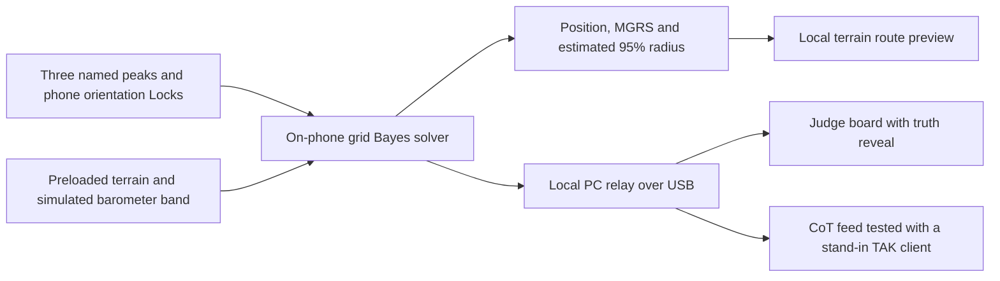

# RIDGELINE · Team 8

Code Metal Forge Hackathon 2026, Operation Lost and Found.
Search and rescue in dangerous environments, built Nov 7 to Nov 8, 2026 at BASE-X Boston.

The [RIDGELINE technical README](ridgeline/README.md) contains the method, trial record and detailed commands. Earlier concepts remain in [Plan.md](Plan.md).

## What it does

When GPS cannot be trusted, RIDGELINE helps a lost person estimate their position from three mountain peaks they can identify. Aim a phone at each peak and tap Lock to get a position, an MGRS grid reference and an estimated 95% uncertainty radius, calculated on the phone from preloaded terrain.

| Item | Answer |
| --- | --- |
| Who uses it | A stranded person or ground responder with a phone and a clear view of identifiable peaks |
| Which objective | OBJ.01 Locate, with terrain-based route previews to support the next decision |
| What breaks today | GPS can be unavailable or misleading, and cellular service may be absent. A useful position must include its uncertainty and work from local data |
| What we show working | Hand-held measurements against three wall cards, a live position on the phone and board, and a cable-disconnected reload and fix. A simulated GPS comparison, route preview and CoT output are implemented, with verification limits below |

**Measured on a real phone** on Nov 8, a hand-held three-Lock wall trial placed the fix 42 m from the known demo position inside a ±293 m circle. A second trial on the then-current build gave 90 m inside ±278 m. These are indoor wall-card trials with a simulated barometer, not outdoor field accuracy claims.

## Team

| Name | GitHub | Role |
| --- | --- | --- |
| Noah Gruenert | @NoahGruenert | Terrain data and map work, terrain navigation prototype |
| Rohan Shah | @Rshah2067 | Topography and localization prototype, peak-selection method |
| Douglas Lilly | @theDclilly | Simulated accelerometer processing and inertial path reconstruction prototype |
| Seika Karamatsu | @sese0318 | Phone experience, live demo integration, operator feedback, measurement record and demo story |

The inertial navigation work in `accelerometer/` is a separate prototype and is not an input to the demonstrated three-peak fix.

## Hardware used

| Hardware | Where it came from | What it does in the system |
| --- | --- | --- |
| Samsung Galaxy S24 Ultra, Chrome 156 | Team phone | Supplies orientation observations and runs the browser solver, map and route preview |
| PC with Python 3 and a browser | Team computer | Serves local files, relays observations to the judge board and exposes the CoT feed |
| USB cable | Team equipment | Connects phone and PC through Android Debug Bridge port reversal |
| Three printed wall cards and a tape measure | Generated from terrain data | Reproduce the peak-to-peak angles of a known synthetic test position indoors |

Raspberry Pi 5 is in the event baseline kit, but this README does not claim a Pi deployment. The demonstrated system runs on the phone and PC. Battery runtime, power draw, total weight and field hardware cost have not been measured.

## How it works



The solver scores a 30 m grid covering 10.4 × 8.0 km near Mount Moran. Each candidate position fits its own constant heading offset, so the angles **between** the Locks matter, rather than absolute compass north. A height band and precomputed peak visibility narrow the result. The same [solver.js](ridgeline/solver.js) runs on the phone, board and in Node tests without third-party JavaScript dependencies.

The phone uses its available browser orientation stream. A constant heading offset cancels, but changing sensor errors do not. The demo height is simulated because the browser does not expose the pressure sensor. A service worker caches the app and terrain after an initial load. The PC is needed for the shared board and CoT relay, not for a cached phone fix.

The GPS comparison uses a **pretend reading** selected in Settings and checks whether it falls outside the terrain fix's 95% circle. The app never reads real GPS and does not detect RF jamming. Terrain visibility suggestions do not guarantee concealment or rescue visibility.

## Setup and build

The live demo needs Python 3, Android Chrome, a USB cable and Google Android Platform Tools (`adb`). Node 18 or newer is needed only for JavaScript tests. Prepared terrain is included, so the live app has no package installation or build step.

① Clone the repository and start the local server.

```bash
git clone https://github.com/CodeMetalForge-Hackathon/Team-8.git
cd Team-8
python -I ridgeline/server.py
```

The server listens on `127.0.0.1:8768`, and its CoT server uses TCP port `8087`. Repository access may require authentication during the event.

② Enable USB debugging, connect the phone and accept its debugging prompt. In a second terminal run

```bash
adb devices
adb reverse tcp:8768 tcp:8768
```

Open [the phone page](http://localhost:8768) in Chrome **on the phone**, and [the board](http://localhost:8768/board) in the PC browser. USB forwarding makes the phone's `localhost` reach the PC. Camera and orientation permission prompts appear on the phone as needed.

③ Print [the wall cards](ridgeline/cards/ridgeline_wall_cards.pdf) on US Letter in landscape orientation and follow page 1. At a 2.00 m viewing distance, aim marks are 1.69 m left, 0.51 m left and 1.69 m right of the center mark. Left to right, the cards are Pk 2958, Raynolds Peak and Bivouac Peak. Measure the marks and viewing distance before a trial.

④ Run the checks from the repository root.

```bash
node --test ridgeline/test/solver.test.js ridgeline/test/hide.test.js ridgeline/test/skyline.test.js
python -I -m unittest discover -s ridgeline/test -p "test_cot.py"
```

For optional ATAK setup and CoT details, see [Hand-off to ATAK](ridgeline/README.md#hand-off-to-atak). A real ATAK-CIV session has not yet been verified.

## How to run the demo

① Open the phone app and board. Explain that the cards reproduce known outdoor geometry, while the barometer and GPS test readings are simulated. Let the offline download finish before removing the cable.

② Stand on the measured floor mark and select **Start terrain fix**. Follow the named target, aim at its card, hold steady and tap **Lock**. Repeat for three targets, letting the aim settle each time. The board draws the observations and uncertainty region as they arrive.

③ Read the MGRS position and estimated 95% radius. Press **R** on the board to reveal the known test position and actual error in meters. A mismatch requests a new observation.

④ Open the position screen to inspect the Rendezvous route and Healthy and Injured options. These are terrain-based previews. When no route is available, the app shows **STAY SIGNAL WAIT**. Water avoidance and final merged route behavior still need a phone verification pass.

⑤ Remove the USB cable after caching, reload the phone page and obtain another fix. Reconnect to update the board. This cable-disconnected reload and fix was recorded at 05:03 EST on Nov 8.

⑥ Optional, pending a real-phone rehearsal, choose the spoofed **Test GPS** reading in Settings to show **GPS REJECTED**. This uses synthetic GPS data, not a live spoofing experiment. Inspect the CoT feed at [the local endpoint](http://localhost:8768/api/cot), without claiming it has been displayed in real ATAK.

For a laptop dry run, arrows aim and Enter Locks. **A** is keyboard-only demo assist that aims at the current card, followed by a pause for the aim to settle. A board map click generates a simulated three-Lock trial. Clearly label either fallback as simulation.

## What we measured

| Test | Condition | Result |
| --- | --- | --- |
| Hand-held wall trial, Nov 8 04:56 EST | Galaxy S24 Ultra, Chrome 156, measured paper marks, three Locks, simulated barometer | Actual error 42 m, estimated radius ±293 m, Enough. Relative angles within 2° of the layout |
| Hand-held wall trial, Nov 8 05:01 EST | Then-current phone build, same wall setup | Actual error 90 m, estimated radius ±278 m, Enough. Rendezvous selected automatically, 3.40 km route displayed |
| Cached phone reload, Nov 8 05:03 EST | USB cable removed, page reloaded, three hand-held Locks | Actual error 212 m, estimated radius ±298 m, Enough. Board received the fix about 1 s after reconnection |
| Misidentified wall cards | Three earlier hand-held trials with cards in the wrong order | Each flagged a mismatch and requested another observation of the last card |
| Solver simulation | 200 fixes at the demo position with Gaussian 3° aim error and random constant heading offset | Median error 98 m, 90th percentile 184 m, truth inside the 95% bubble in 99.0%, slowest solve 156 ms |
| Solver simulation across the tile | 120 random positions with three visible peaks | Median error 132 m, 90th percentile 540 m, truth inside the bubble in 99.2% |
| JavaScript checks | Solver, visibility suggestions, walkable start, expected skyline | Recorded 21 of 21 passing, comprising 6 solver, 9 hide and 6 skyline tests |
| CoT checks | Stand-in TAK client and local push listener | Recorded 10 of 10 passing, including fix, uncertainty, route, marks, rejected GPS point, reconnect and reset deletes. Lock relay under 0.25 s with the test client connected |

Source is [the detailed test log](ridgeline/README.md#test-results-gate-a), dated Nov 8, 2026. Rerun checks after integration. Simulation results are not hand-held accuracy measurements, and the 42 m result is one wall trial, not guaranteed accuracy. No outdoor trial, battery test or real RF spoofing test is recorded.

## Limits and path to deployment

| Current limit | Next step |
| --- | --- |
| Indoor cards replace mountains, and operators must identify the peaks | Repeat outdoor trials across users and visibility conditions with independent ground truth |
| Height is simulated, and the nominal 95% radius depends on the error model | Integrate a calibrated pressure sensor. In the recorded simulation, a 60 m barometer reference error reduced coverage to about 70% without a mismatch warning |
| Solver assumes 3° aim error and a constant heading offset | Characterize real sensor streams and handling. At 10° simulated aim error, the nominal 95% area held truth only about half the time |
| GPS REJECTED uses synthetic data and is unverified on the real phone | Rehearse the phone flow, then evaluate independent real positioning inputs and failure cases |
| CoT passed stand-in client tests, but real ATAK-CIV is untested | Verify connection, rendering and deletion in actual ATAK. Replace the local unencrypted demo link with suitable field transport |
| Water avoidance awaits final integration and phone verification | Validate planner and map masks, blocked destinations and unreachable routes. Terrain visibility does not model trees, buildings or current hazards |
| Night mode, Lock vibration and airplane mode with the cable are unverified on the phone | Complete a device acceptance pass including camera, offline startup and the entire demo |
| No field endurance, size, weight or cost measurements | Profile battery and storage on target hardware. Porting the dependency-free solver to an embedded runtime is a next step, not a demonstrated result |

## Credits

Pre-existing libraries, frameworks, SDKs and datasets used across this repository, including earlier prototypes. The live demo uses the Moran terrain bundle and dependency-free browser solver. Project code is licensed under [Apache 2.0](LICENSE).

| Name | License | Used for |
| --- | --- | --- |
| Medić et al. 2024, Drones 8(3) 76 | CC BY 4.0 | Thermal contrast and altitude numbers for a person in water (`data/literature/`) |
| Burke et al. 2019, Drones 3(4) 78 | CC BY 4.0 | Detection altitude versus contrast and pixel size (`data/literature/`) |
| NOAA NDBC buoy 44013 | U.S. Government data, public domain | Snapshot of water temperature, wind and waves (`data/ndbc/`) |
| SeaDronesSee Multi-Object Tracking (planned) | CC0 1.0 | Replay of real drone telemetry, kept out of the repo (`data/raw/`) |
| USGS 3DEP 1 m lidar (via OpenTopography) | U.S. Government data, public domain | Mount Moran terrain for the judge view (`terrain_viewer/data/moran/`) |
| USGS 3DEP 1/3 arc-second DEM | U.S. Government data, public domain | Mount Washington terrain (`terrain_viewer/data/washington/`) |
| Copernicus DEM GLO-30 | Copernicus DEM licence, free use with attribution (© DLR e.V. 2010-2014 and © Airbus Defence and Space GmbH 2014-2018, provided under COPERNICUS by the EU and ESA) | Mount Fuji terrain (`terrain_viewer/data/fuji/`) |
| ESA WorldCover 10 m 2021 v200 | CC BY 4.0 | Woods, rock and water tints on the map (`terrain_viewer/data/*/topo.jpg`) |
| Wikidata | CC0 1.0 | Summit, lake and glacier names in `terrain_viewer/` |
| World Magnetic Model WMM2025 (NOAA NCEI and BGS) | U.S. Government data, public domain | Magnetic declination per tile, coefficients in `terrain_viewer/scripts/wmm/` |
| deck.gl 9.3.11 | MIT | 3D terrain rendering in `terrain_viewer/`, shipped locally in `terrain_viewer/lib/` |
| Noto Sans JP, B612 Mono (via Fontsource) | SIL OFL 1.1 | Fonts in `terrain_viewer/`, license texts in `terrain_viewer/lib/fonts/` |
| loaders.gl 4.4.3 terrain worker | MIT | Terrain decoding in `mockups/map_3d/`, shipped in `mockups/map_3d/lib/` |
| NumPy, SciPy, rasterio, contourpy, pyserial | BSD-3-Clause | Offline data prep scripts (contour lines with contourpy), and the USB reader in `mockups/sighting_box/` |
| Pillow | MIT-CMU (HPND) | Writing map images in the data prep scripts |
| OpenCV (opencv-python) | Apache 2.0 | Outlines of the probability regions in `mockups/map_3d/export_3d_assets.py` |

## Submission checklist

- [x] README sections above are filled in with measured results and explicit limits
- [ ] No secrets, CUI, ITAR, or real personal data committed (use `.env`, see `.gitignore`)
- [ ] Large files use Git LFS or external links
- [ ] Final commit is on `main` before Sun Nov 8, 12:00 PM EST
- [ ] `git tag submission && git push origin submission`
