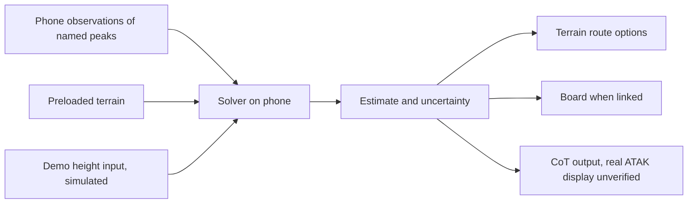

# RIDGELINE, Team 8

Code Metal Forge Hackathon 2026, Operation Lost and Found.
Search and rescue in dangerous environments, built Nov 7 to Nov 8, 2026 at BASE-X Boston.

The demonstration entry point is [ridgeline/](ridgeline/README.md). [Judging evidence](docs/JUDGING_EVIDENCE.md) separates recorded phone trials, simulated results and work still to verify. [Plan.md](Plan.md) contains earlier ideas, including approaches that are not part of this demo.

## What it does

RIDGELINE estimates a person's position from the angles between known mountain peaks and a preloaded terrain map when GPS is unavailable. It shows the position uncertainty and terrain-constrained route options, so the person and a responder can see both the estimate and its limits.

The event demo uses a real phone aimed by hand at three printed mountain cards. Their positions on a wall reproduce the angles from one location near Mount Moran. The height input is simulated. This demonstrates the phone-to-estimate workflow in a controlled setting, and does not establish accuracy in real mountains.

| Item | Answer |
| --- | --- |
| Who uses it | An isolated person who can identify visible peaks, with a responder viewing the shared estimate when a link is available |
| Which objective | Primarily OBJ.01, Locate Isolated People. CoT output provides a path toward OBJ.04, Deliver Critical Information |
| Operating assumptions | The terrain tile is loaded in advance, the landmarks are identified correctly and useful sightlines are available |
| Recorded working flow | Hand-held phone observations, a terrain estimate with a probability region, a route display and an offline reload followed by reconnection to the board |
| Still to establish | Real-mountain accuracy, reliable height input, use under poor visibility, battery endurance and display in a real ATAK client |

## Team

| Name | GitHub | Role |
| --- | --- | --- |
| Noah Gruenert | @NoahGruenert | Terrain and route algorithm work |
| @Rshah2067 | @Rshah2067 | Name and role confirmation pending |
| @theDclilly | @theDclilly | Name and role confirmation pending |
| Seika Karamatsu | @sese0318 | Design, operator interviews, demo story |

## Hardware used

| Hardware | Where it came from | What it does in the system |
| --- | --- | --- |
| Samsung Galaxy S24 Ultra, Chrome 156 | Team test phone | Orientation observations, camera aiming view and local position solver |
| PC with Python 3 and a browser | Team PC | Initial file serving, observation relay and the large board display |
| USB data cable with Android platform-tools | Demo connection | Localhost access through `adb reverse` and relay to the board |
| Three printed cards, a tape measure and a marked standing position | Demo fixture | Controlled angular geometry for the phone trial |

The demo does not use a Raspberry Pi or a physical barometer reading. Keyboard input is available for a PC dry run, and is separate from a hand-held phone trial.

## How it works

The phone records a heading for each named landmark. A grid-based Bayesian solver fits a constant heading offset at each candidate location, compares the angle differences with the terrain, and uses a height band and visibility model. The map shows the estimate and its model-based 95% probability region. Route planning uses the terrain water, cliff and slope constraints.



The algorithm does not require a known absolute north heading. The browser can fall back to an absolute orientation stream, so this is not a claim that the phone never uses a magnetometer. A constant offset fit does not remove changing sensor errors. See the [implementation notes](ridgeline/README.md#how-the-fix-works).

## Setup and build

The committed terrain and app files are sufficient for the demo. Python 3 is required on the PC. Node 18 or newer is needed only for the JavaScript tests. Android platform-tools is needed for the USB connection. No Python package installation or terrain rebuild is required to run this entry point.

① From the repository root, keep this command running on the PC.

```bash
python -I ridgeline/server.py
```

② On the Android phone, enable USB debugging, connect the data cable and accept the PC authorization prompt. On the PC, run the following command.

```bash
adb reverse tcp:8768 tcp:8768
```

③ Open [the phone app](http://localhost:8768/) in Chrome on the phone and allow the requested motion and camera permissions. On the PC, open [the board](http://localhost:8768/board). The server binds only to the PC's loopback address. A phone without the USB reverse connection cannot reach that PC address directly.

④ Print [the wall cards](ridgeline/cards/ridgeline_wall_cards.pdf) and follow page 1 to place the targets and standing mark. Keep the phone connected while the app and terrain are loaded before attempting an offline reload. See [the detailed run instructions](ridgeline/README.md#run-it) for the card layout and optional CoT connection.

## How to run the demo

① Explain the test boundary before starting. These are real phone observations of wall cards, with simulated height and a known terrain location for answer checking.

② From the marked position, start a terrain fix and aim at each requested card in order. Tap Lock. Show how the probability region changes and retain any request to re-aim.

③ Show the position and uncertainty, then press R on the PC board to compare with the known demonstration location. Select a destination and show the terrain constraints. A reachable route in this map model is not a guarantee that a person can traverse it in the field.

④ After confirming the app has been cached, unplug the cable, reload the phone app and repeat the observations. Reconnect and check that the board receives the latest state. Airplane mode is a separate verification step in the [five-trial protocol](docs/JUDGING_EVIDENCE.md#five-trial-repeatability-record).

⑤ For the model sensitivity results, open [Trust](http://localhost:8768/trust) on the PC. Label this view as simulation. Clicking the board map also creates simulated observations, and must not be presented as a phone measurement.

## What we measured

| Recorded trial on 2026-11-08, EST | Condition | Result |
| --- | --- | --- |
| 04:56 | Hand-held Galaxy, tape-measured wall layout, simulated height | Position error 42 m, displayed radius 293 m, Enough |
| 05:01 | Hand-held Galaxy, same controlled wall task | Position error 90 m, displayed radius 278 m, Enough, a 3.40 km route displayed |
| 05:03 | Cable removed, phone page reloaded from its offline copy, three Locks | Position error 212 m, displayed radius 298 m, Enough. Board received the fix about 1 s after reconnection |

These are historical observations copied from [the RIDGELINE test record](ridgeline/README.md#test-results-gate-a), not new measurements of this review revision. They are not a five-trial series or a field-accuracy estimate. Earlier mismatches and a less accurate wall setup are retained in [the evidence document](docs/JUDGING_EVIDENCE.md#recorded-phone-observations).

The solver tests and Trust view are a separate evidence class. For example, the recorded 200-run simulation at the demo location with 3° Gaussian aim noise produced a 98 m median error and 99% inclusion in the nominal 95% region. This result is conditional on the simulation inputs and is not a measurement of human performance.

Run the regression checks for the exact revision used in the demo.

```bash
node --test ridgeline/test/solver.test.js ridgeline/test/hide.test.js ridgeline/test/skyline.test.js terrain_viewer/tests/nav_water.test.mjs
python -I -m unittest discover -s ridgeline/test -p "test_*.py"
```

The CoT tests use a stand-in client. A passing result does not establish how the objects appear in ATAK.

## Limits and path to deployment

| Limit now | Next validation |
| --- | --- |
| Peaks are identified by the user, and the wall cards reproduce a chosen geometry | Use independently identified landmarks and held-out locations outdoors, including incorrect identifications and poor geometry |
| The height input is simulated | Read and calibrate a real height source, measure drift, and widen or remove the height constraint when it is unreliable |
| The 95% region assumes a particular observation model | Measure coverage under real aiming errors. In the recorded simulation a 60 m height bias reduced coverage to about 70% |
| Route and visibility results describe terrain data | Verify route origin, water boundaries and field obstacles. Trees, weather and buildings are not a full part of this model |
| Test GPS is a manually supplied comparison point | Treat disagreement as a reason to cross-check both estimates, not proof of spoofing |
| CoT output is checked with a stand-in client | Verify connection, coordinates, uncertainty, route display and reset in a real ATAK client |
| Offline reload is recorded for one phone setup | Repeat with airplane mode, cold reload and reconnection. Measure power consumption, setup time and use by an unfamiliar operator |

ATAK already provides mapping and resection capabilities. RIDGELINE explores a guided observation and uncertainty workflow that can supply an estimate to existing tools. We do not claim that resection is new or that RIDGELINE replaces ATAK. See [the comparison boundary](docs/JUDGING_EVIDENCE.md#relationship-to-atak).

## Credits

Pre-existing open-source libraries, frameworks, SDKs, and datasets used in this project.

| Name | License | Used for |
| --- | --- | --- |
| Medić et al. 2024, Drones 8(3) 76 | CC BY 4.0 | Thermal contrast and altitude numbers for a person in water (`data/literature/`) |
| Burke et al. 2019, Drones 3(4) 78 | CC BY 4.0 | Detection altitude versus contrast and pixel size (`data/literature/`) |
| NOAA NDBC buoy 44013 | U.S. Government data, public domain | Snapshot of water temperature, wind and waves (`data/ndbc/`) |
| SeaDronesSee Multi-Object Tracking (planned) | CC0 1.0 | Replay of real drone telemetry, kept out of the repo (`data/raw/`) |
| USGS 3DEP 1 m lidar (via OpenTopography) | U.S. Government data, public domain | Mount Moran terrain for the judge view (`terrain_viewer/data/moran/`) |
| USGS 3DEP 1/3 arc-second DEM | U.S. Government data, public domain | Mount Washington terrain (`terrain_viewer/data/washington/`) |
| Copernicus DEM GLO-30 | Copernicus DEM licence, free use with attribution (© DLR e.V. 2010-2014 and © Airbus Defence and Space GmbH 2014-2018, provided under COPERNICUS by the EU and ESA) | Mount Fuji terrain (`terrain_viewer/data/fuji/`) |
| ESA WorldCover 10 m 2021 v200 | CC BY 4.0 | Woods, rock and water tints on the map (`terrain_viewer/data/*/topo.jpg`) |
| Wikidata | CC0 1.0 | Summit, lake and glacier names in `terrain_viewer/` |
| World Magnetic Model WMM2025 (NOAA NCEI and BGS) | U.S. Government data, public domain | Magnetic declination per tile, coefficients in `terrain_viewer/scripts/wmm/` |
| deck.gl 9.3.11 | MIT | 3D terrain rendering in `terrain_viewer/`, shipped locally in `terrain_viewer/lib/` |
| Noto Sans JP, B612 Mono (via Fontsource) | SIL OFL 1.1 | Fonts in `terrain_viewer/`, license texts in `terrain_viewer/lib/fonts/` |
| loaders.gl 4.4.3 terrain worker | MIT | Terrain decoding in `mockups/map_3d/`, shipped in `mockups/map_3d/lib/` |
| NumPy, SciPy, rasterio, contourpy, pyserial | BSD-3-Clause | Offline data prep scripts (contour lines with contourpy), and the USB reader in `mockups/sighting_box/` |
| Pillow | MIT-CMU (HPND) | Writing map images in the data prep scripts |
| OpenCV (opencv-python) | Apache 2.0 | Outlines of the probability regions in `mockups/map_3d/export_3d_assets.py` |

## Submission checklist

- [ ] Confirm remaining team names and roles
- [ ] Run the exact submitted revision and record remaining phone checks
- [ ] Check for secrets, CUI, ITAR and unconsented personal data (use `.env`, see `.gitignore`)
- [ ] Large files use Git LFS or external links
- [ ] Final commit is on `main` before Sun Nov 8, 12:00 PM EST
- [ ] `git tag submission && git push origin submission`
