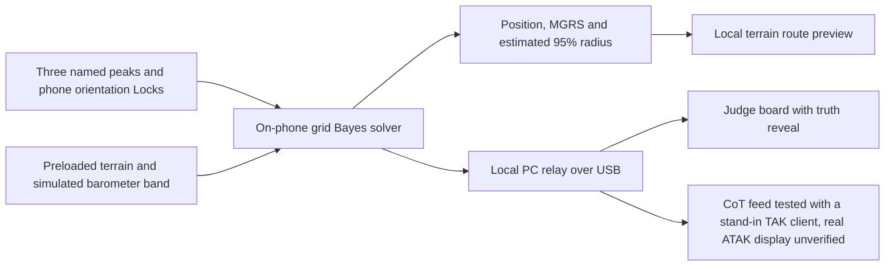

# RIDGELINE · Team 8

Code Metal Forge Hackathon 2026, Operation Lost and Found.
Search and rescue in dangerous environments, built Nov 7 to Nov 8, 2026 at BASE-X Boston.

The demonstration entry point is [the RIDGELINE technical README](ridgeline/README.md), with the method, trial record and detailed commands. [Judging evidence](docs/JUDGING_EVIDENCE.md) separates recorded phone trials, simulated results and work still to verify. [Plan.md](Plan.md) contains earlier ideas, including approaches that are not part of this demo.

## What it does

RIDGELINE estimates a person's position from the angles between known mountain peaks and a preloaded terrain map when GPS is unavailable. Aim a phone at each of three peaks you can identify and tap Lock. The phone shows the estimate, an MGRS grid reference, its modelled 95% uncertainty radius and terrain-constrained route options, so the person and a responder can see both the estimate and its limits.

The event demo uses a real phone aimed by hand at three printed mountain cards. Their positions on a wall reproduce the angles from one location near Mount Moran. The height input is simulated. This demonstrates the phone-to-estimate workflow in a controlled setting, and does not establish accuracy in real mountains.

| Item | Answer |
| --- | --- |
| Who uses it | An isolated person who can identify visible peaks, with a responder viewing the shared estimate when a link is available |
| Which objective | Primarily OBJ.01, Locate Isolated People, with terrain-based route previews to support the next decision. CoT output provides a path toward OBJ.04, Deliver Critical Information |
| What breaks today | GPS can be unavailable or misleading, and cellular service may be absent. A useful position must include its uncertainty and work from local data |
| Operating assumptions | The terrain tile is loaded in advance, the landmarks are identified correctly and useful sightlines are available |
| What we show working | Hand-held phone observations of three wall cards, a terrain estimate with a probability region on the phone and board, a route display, and an offline reload followed by reconnection to the board, all recorded on a real phone. A simulated GPS comparison and CoT output are implemented, with verification limits below |
| Still to establish | Real-mountain accuracy, reliable height input, use under poor visibility, battery endurance and display in a real ATAK client |

**Measured on a real phone** on Nov 8, a hand-held three-Lock wall trial placed the fix 42 m from the known demo position inside a ±293 m circle. A second trial on the then-current build gave 90 m inside ±278 m. These are indoor wall-card trials with a simulated barometer, not outdoor field accuracy claims.

## Team

| Name | GitHub | Role |
| --- | --- | --- |
| Noah Gruenert | @NoahGruenert | Terrain data and map work, terrain navigation prototype |
| Rohan Shah | @Rshah2067 | Topography and localization prototype, peak-selection method |
| Douglas Lilly | @theDclilly | Simulated accelerometer processing and inertial path reconstruction prototype |
| Seika Karamatsu | @sese0318 | Phone experience, live demo integration, operator feedback, measurement record and demo story |

The inertial navigation work in `accelerometer/` is a separate prototype and is not an input to the demonstrated three-peak fix.

## Hardware used

| Hardware | Where it came from | What it does in the system |
| --- | --- | --- |
| Samsung Galaxy S24 Ultra, Chrome 156 | Team phone | Supplies orientation observations, shows the camera aiming view and runs the browser solver, map and route preview |
| PC with Python 3 and a browser | Team computer | Serves local files, relays observations to the judge board and exposes the CoT feed |
| USB data cable with Android platform-tools | Team equipment | Connects phone and PC through Android Debug Bridge port reversal (`adb reverse`) |
| Three printed wall cards, a tape measure and a marked standing position | Generated from terrain data | Reproduce the peak-to-peak angles of a known synthetic test position indoors |

Raspberry Pi 5 is in the event baseline kit, but the demo does not use it and this README does not claim a Pi deployment. The demonstrated system runs on the phone and PC, without a physical barometer reading. Battery runtime, power draw, total weight and field hardware cost have not been measured. Keyboard input is available for a PC dry run, and is separate from a hand-held phone trial.

## How it works

The phone records a heading for each named landmark. A grid-based Bayesian solver fits a constant heading offset at each candidate location, compares the angle differences with the terrain, and uses a height band and visibility model. The map shows the estimate and its model-based 95% probability region. Route planning uses the terrain water, cliff and slope constraints.



The solver scores a 30 m grid covering 10.4 × 8.0 km near Mount Moran. Each candidate position fits its own constant heading offset, so the angles **between** the Locks matter, rather than absolute compass north. A height band and precomputed peak visibility narrow the result. The same [solver.js](ridgeline/solver.js) runs on the phone, board and in Node tests without third-party JavaScript dependencies.

The phone uses its available browser orientation stream. The browser can fall back to an absolute orientation stream, so this is not a claim that the phone never uses a magnetometer. A constant heading offset cancels, but changing sensor errors do not. The demo height is simulated because the browser does not expose the pressure sensor. A service worker caches the app and terrain after an initial load. The PC is needed for the shared board and CoT relay, not for a cached phone fix. See the [implementation notes](ridgeline/README.md#how-the-fix-works).

The GPS comparison uses a **simulated reading** selected in Settings. Outside the terrain estimate's modelled 95% circle, the phone and board show **GPS DISAGREES** with the distance, and inside they show **GPS CONSISTENT**. Neither result establishes which position is correct, and a disagreement is not a spoofing detector. Terrain, height, orientation or the test point may be wrong. The internal verdict value stays `REJECTED` for compatibility and means disagreement only. The app never reads real GPS and does not detect RF jamming. Terrain visibility suggestions do not guarantee concealment or rescue visibility.

When the estimate falls on ground steeper than the limit, on water or on a boxed-in ledge, routes begin at a **candidate start** on nearby walkable ground inside the 95% circle. The phone marks that candidate without a connecting line, because walking there from the estimate is not verified, and asks the user to confirm their position and the terrain first.

## Setup and build

The live demo needs Python 3, Android Chrome, a USB cable and Google Android Platform Tools (`adb`). Node 18 or newer is needed only for JavaScript tests. Prepared terrain is included, so the live app needs no Python package installation, terrain rebuild or build step.

① Clone the repository and start the local server.

```bash
git clone https://github.com/CodeMetalForge-Hackathon/Team-8.git
cd Team-8
python -I ridgeline/server.py
```

The server listens on `127.0.0.1:8768`, and its CoT server uses TCP port `8087`. It binds only to the PC's loopback address, so a phone without the USB reverse connection cannot reach it directly. Repository access may require authentication during the event.

② Enable USB debugging, connect the phone and accept its debugging prompt. In a second terminal run

```bash
adb devices
adb reverse tcp:8768 tcp:8768
```

Open [the phone page](http://localhost:8768) in Chrome **on the phone**, and [the board](http://localhost:8768/board) in the PC browser. USB forwarding makes the phone's `localhost` reach the PC. Camera and orientation permission prompts appear on the phone as needed.

③ Print [the wall cards](ridgeline/cards/ridgeline_wall_cards.pdf) on US Letter in landscape orientation and follow page 1. At a 2.00 m viewing distance, aim marks are 1.69 m left, 0.51 m left and 1.69 m right of the center mark. Left to right, the cards are Pk 2958, Raynolds Peak and Bivouac Peak. Measure the marks and viewing distance before a trial. See [the detailed run instructions](ridgeline/README.md#run-it) for the card layout and optional CoT connection.

④ Run the checks from the repository root.

```bash
node --test ridgeline/test/solver.test.js ridgeline/test/hide.test.js ridgeline/test/skyline.test.js ridgeline/test/lock.test.js terrain_viewer/tests/nav_water.test.mjs
python -I -m unittest discover -s ridgeline/test -p "test_*.py"
```

For optional ATAK setup and CoT details, see [Hand-off to ATAK](ridgeline/README.md#hand-off-to-atak). A real ATAK-CIV session has not yet been verified.

## How to run the demo

① Open the phone app and board. Explain the test boundary before starting. These are real phone observations of wall cards that reproduce known outdoor geometry, with a simulated height, simulated GPS test readings and a known terrain location for answer checking. Keep the phone connected until the app and terrain have been cached.

② Stand on the measured floor mark and select **Start terrain fix**. Follow the named target, aim at its card, hold steady and tap **Lock**. Repeat for three targets, letting the aim settle each time. The board draws the observations and uncertainty region as they arrive. Show how the probability region changes and keep any request to re-aim.

③ Read the MGRS position and estimated 95% radius. Press **R** on the board to reveal the known test position and actual error in meters. A mismatch requests a new observation.

④ Open the position screen to inspect the Rendezvous route and Healthy and Injured options. These are terrain-based previews, and a reachable route in this map model is not a guarantee that a person can traverse it in the field. A route that begins at a candidate start does not show a verified walk from the estimate. When no route is available, the app shows **STAY SIGNAL WAIT**. Water avoidance and final merged route behavior still need a phone verification pass.

⑤ Remove the USB cable after caching, reload the phone page and obtain another fix. Reconnect to update the board. This cable-disconnected reload and fix was recorded at 05:03 EST on Nov 8. Airplane mode is a separate verification step in the [five-trial protocol](docs/JUDGING_EVIDENCE.md#five-trial-repeatability-record).

⑥ Choose the far **Test GPS** point in Settings. The phone and board show **GPS DISAGREES** with the distance, and the cause is unknown. On Nov 8 Seika confirmed seeing GPS REJECTED, the earlier label for this same result, on the real phone. The exact build and test input were not recorded. This uses a simulated GPS reading, not a live spoofing experiment. Inspect the CoT feed at [the local endpoint](http://localhost:8768/api/cot), without claiming it has been displayed in real ATAK.

⑦ For the model sensitivity results, open [Trust](http://localhost:8768/trust) on the PC. Label this view as simulation.

For a laptop dry run, arrows aim and Enter Locks. **A** is keyboard-only demo assist that aims at the current card. After Enter, wait for the target name to change before pressing A for the next observation. Further taps, clicks or Enter presses are ignored until an accepted Lock has been solved and drawn, and for 600 ms after it, so a quick double tap records the peak once. A board map click generates a simulated three-Lock trial. Clearly label either fallback as simulation, and never present it as a phone measurement.

## What we measured

| Test | Condition | Result |
| --- | --- | --- |
| Hand-held wall trial, Nov 8 04:56 EST | Galaxy S24 Ultra, Chrome 156, measured paper marks, three Locks, simulated barometer | Actual error 42 m, estimated radius ±293 m, Enough. Relative angles within 2° of the layout |
| Hand-held wall trial, Nov 8 05:01 EST | Then-current phone build, same wall setup | Actual error 90 m, estimated radius ±278 m, Enough. Rendezvous selected automatically, 3.40 km route displayed |
| Cached phone reload, Nov 8 05:03 EST | USB cable removed, page reloaded from its offline copy, three hand-held Locks | Actual error 212 m, estimated radius ±298 m, Enough. Board received the fix about 1 s after reconnection |
| Real-phone GPS comparison, Nov 8 | User confirmation from Seika, exact build and input not recorded | The phone showed GPS REJECTED, the label at that time. The same result is now labelled GPS DISAGREES. This is not evidence of a live RF spoofing trial |
| Misidentified wall cards | Three earlier hand-held trials with cards in the wrong order | Each flagged a mismatch and requested another observation of the last card |
| Solver simulation | 200 fixes at the demo position with Gaussian 3° aim error and random constant heading offset | Median error 98 m, 90th percentile 184 m, truth inside the 95% bubble in 99.0%, slowest solve 156 ms |
| Solver simulation across the tile | 120 random positions with three visible peaks | Median error 132 m, 90th percentile 540 m, truth inside the bubble in 99.2% |
| JavaScript checks, rerun after merging the judging review on Nov 8 | Solver, visibility suggestions, walkable start, expected skyline, Lock input and route water checks | 34 of 34 passing, comprising 6 solver, 9 hide, 6 skyline, 6 Lock input and 7 route tests |
| Python checks, rerun after merging the judging review on Nov 8 | Stand-in TAK client, local push listener and the trial capture script | 20 of 20 passing. The 10 CoT tests cover fix, uncertainty, route, marks, the disagreeing GPS test point, reconnect and reset deletes. Previously recorded Lock relay under 0.25 s with the test client connected |

Source is [the detailed test log](ridgeline/README.md#test-results-gate-a), dated Nov 8, 2026. The phone rows are historical observations, not new measurements of this merged revision, and they are not a five-trial series or a field-accuracy estimate. Earlier mismatches and a less accurate wall setup are retained in [the evidence document](docs/JUDGING_EVIDENCE.md#recorded-phone-observations). Simulation results are a separate evidence class, conditional on the simulation inputs, and are not hand-held accuracy or human performance measurements. The 42 m result is one wall trial, not guaranteed accuracy. No outdoor trial, battery test or real RF spoofing test is recorded.

Run the checks in Setup step ④ again on the exact revision used in the demo. The CoT tests use a stand-in client. A passing result does not establish how the objects appear in ATAK.

## Limits and path to deployment

| Current limit | Next step |
| --- | --- |
| Indoor cards replace mountains, and operators must identify the peaks | Repeat outdoor trials across users and visibility conditions with independent ground truth and held-out locations, including incorrect identifications and poor geometry |
| Height is simulated, and the nominal 95% radius depends on the error model | Integrate and calibrate a pressure sensor, measure drift, and widen or remove the height constraint when it is unreliable. In the recorded simulation, a 60 m barometer reference error reduced coverage to about 70% without a mismatch warning |
| Solver assumes 3° aim error and a constant heading offset | Measure coverage under real aiming errors and sensor streams. At 10° simulated aim error, the nominal 95% area held truth only about half the time |
| Test GPS is a manually supplied comparison point. GPS REJECTED, the label at the time, was observed on the real phone and confirmed by Seika on Nov 8, with the exact build and input not recorded | Repeat with the GPS DISAGREES label in the final merged build. Treat disagreement as a reason to cross-check both estimates, not proof of spoofing, then evaluate independent real positioning inputs and failure cases |
| CoT passed stand-in client tests, but real ATAK-CIV is untested | Verify connection, coordinates, uncertainty, route display and deletion in actual ATAK. Replace the local unencrypted demo link with suitable field transport |
| Route and visibility results describe terrain data. Water avoidance passes merged automated tests but awaits phone verification, and a candidate start is not a verified walk from the estimate | Verify route origin, planner and map masks, blocked destinations and unreachable routes. Trees, weather, buildings and current hazards are not a full part of this model |
| Offline reload is recorded for one phone setup. Night mode, Lock vibration and airplane mode with the cable are unverified on the phone | Repeat with airplane mode, cold reload and reconnection, and complete a device acceptance pass including camera, offline startup, setup time and use by an unfamiliar operator |
| No field endurance, size, weight or cost measurements | Profile battery and storage on target hardware. Porting the dependency-free solver to an embedded runtime is a next step, not a demonstrated result |

ATAK already provides mapping and resection capabilities. RIDGELINE explores a guided observation and uncertainty workflow that can supply an estimate to existing tools. We do not claim that resection is new or that RIDGELINE replaces ATAK. See [the comparison boundary](docs/JUDGING_EVIDENCE.md#relationship-to-atak).

## Credits

Pre-existing libraries, frameworks, SDKs and datasets used across this repository, including earlier prototypes. The live demo uses the Moran terrain bundle and dependency-free browser solver. Project code is licensed under [Apache 2.0](LICENSE).

| Name | License | Used for |
| --- | --- | --- |
| Medić et al. 2024, Drones 8(3) 76 | CC BY 4.0 | Thermal contrast and altitude numbers for a person in water (`data/literature/`) |
| Burke et al. 2019, Drones 3(4) 78 | CC BY 4.0 | Detection altitude versus contrast and pixel size (`data/literature/`) |
| NOAA NDBC buoy 44013 | U.S. Government data, public domain | Snapshot of water temperature, wind and waves (`data/ndbc/`) |
| SeaDronesSee Multi-Object Tracking (planned) | CC0 1.0 | Replay of real drone telemetry, kept out of the repo (`data/raw/`) |
| USGS 3DEP 1 m lidar (via OpenTopography) | U.S. Government data, public domain | Mount Moran terrain for the judge view (`terrain_viewer/data/moran/`) |
| USGS 3DEP 1/3 arc-second DEM | U.S. Government data, public domain | Mount Washington terrain (`terrain_viewer/data/washington/`) |
| Copernicus DEM GLO-30 | Copernicus DEM licence, free use with attribution (© DLR e.V. 2010-2014 and © Airbus Defence and Space GmbH 2014-2018, provided under COPERNICUS by the EU and ESA) | Mount Fuji terrain (`terrain_viewer/data/fuji/`) |
| ESA WorldCover 10 m 2021 v200 | CC BY 4.0 | Woods, rock and water tints on the map (`terrain_viewer/data/*/topo.jpg`) |
| Wikidata | CC0 1.0 | Summit, lake and glacier names in `terrain_viewer/` |
| World Magnetic Model WMM2025 (NOAA NCEI and BGS) | U.S. Government data, public domain | Magnetic declination per tile, coefficients in `terrain_viewer/scripts/wmm/` |
| deck.gl 9.3.11 | MIT | 3D terrain rendering in `terrain_viewer/`, shipped locally in `terrain_viewer/lib/` |
| Noto Sans JP, B612 Mono (via Fontsource) | SIL OFL 1.1 | Fonts in `terrain_viewer/` and the phone display, license texts in `terrain_viewer/lib/fonts/` |
| loaders.gl 4.4.3 terrain worker | MIT | Terrain decoding in `mockups/map_3d/`, shipped in `mockups/map_3d/lib/` |
| NumPy, SciPy, rasterio, contourpy, pyserial | BSD-3-Clause | Offline data prep scripts (contour lines with contourpy), and the USB reader in `mockups/sighting_box/` |
| Pillow | MIT-CMU (HPND) | Writing map images in the data prep scripts |
| OpenCV (opencv-python) | Apache 2.0 | Outlines of the probability regions in `mockups/map_3d/export_3d_assets.py` |

## Submission checklist

- [x] README sections above are filled in with measured results and explicit limits
- [ ] Confirm each team member's role
- [ ] Run the exact submitted revision and record remaining phone checks
- [ ] Check for secrets, CUI, ITAR and unconsented personal data (use `.env`, see `.gitignore`)
- [ ] Large files use Git LFS or external links
- [ ] Final commit is on `main` before Sun Nov 8, 12:00 PM EST
- [ ] `git tag submission && git push origin submission`
