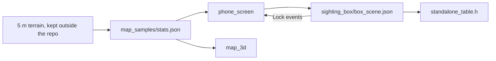

# Mockups

Prototypes built on Nov 7 for the GPS-denied land navigation idea (a downed pilot near Mount Moran finds their position by pointing at peaks, then walks to a safe spot). They all use the same synthetic scenario and the same terrain. No real person's image or location is in any of them.

These are snapshots from the evening of Nov 7 EST. Each one replays a fixed scenario and none of them has been tested in the field or on the real kit hardware yet.

| Folder | What it is | Who looks at it | Open it |
| --- | --- | --- | --- |
| [phone_screen](phone_screen/) | The pilot's phone. No map, just sensor status, aim at a peak and Lock, a big arrow, and "Stay. Signal. Wait." when injured | Pilot | `python -I -m http.server 8768 --bind 127.0.0.1` in the folder, then http://127.0.0.1:8768 |
| [map_3d](map_3d/) | A 3D map with an eye view from the current best guess, stepping through GPS jammed, barometer, first peak, two more peaks, and the route | Judges, rescuers | `python -I -m http.server 8780 --bind 127.0.0.1` in the folder, then http://127.0.0.1:8780 |
| [sighting_box](sighting_box/) | The handheld sighting box. Step-by-step wiring guide, a print sheet for placing the peak pictures on the wall, and a small server that turns the box's button presses into Lock events | Builders | `python -I box_server.py --demo` in the folder, then http://localhost:8765/guide.html and http://localhost:8765/poster_sheet.html |
| [sighting_box/standalone_table](sighting_box/standalone_table/) | A lookup table that lets the box work on battery alone, with no PC or phone. Measure three peaks, find the closest row, show the walking direction and pace count | Builders | `out/standalone_table.h`, include it in the Arduino sketch |
| [map_samples](map_samples/) | Six still maps and the numbers behind them (`stats.json`). Every other mockup takes its peaks and sample observations from here | Everyone | Open the PNGs |

`terrain_viewer/` at the repo root is the other 3D view of the same scenario (one HTML file that opens by double-click). `map_3d` and `terrain_viewer` overlap, so the team should pick one for the demo.

## How they connect



The phone and the box describe a Lock with the same four things (which peak, bearing from true north, elevation angle, time), but the field names differ. The phone uses `peak_id`, `peak_name`, `bearing_true_deg`, `elevation_deg`, `timestamp`, and the box uses `peak`, `bearing_true`, `elev_deg`, `time`. Wiring the box into the phone needs a small adapter, which is not written yet.

## Notes per mockup

**phone_screen** Five screens, keyboard driven (J jams GPS, arrows aim, Enter locks, I toggles injury, R opens the radio report). It records the Lock but plays back fixed estimates, so changing the peak order does not change the answer. Magnetic declination is a placeholder 0°. Full controls and limits are in its README.

The page runs on `phone_state.json` alone. To rebuild that file, run `python -I export_phone_state.py --dem <dem_5m.tif> --stats ../map_samples/stats.json` in the folder. Both flags are needed, because the default DEM file is not in the repo and the default stats path points outside it.

**map_3d** Arrow keys step through the fix, I switches healthy 30° and injured 18°, G jams GPS, W shows where three or more peaks are in view. It needs the local server because the page reads `state.json`. The terrain tifs were left out because the page does not use them. `export_3d_assets.py` rebuilds `data/` and `state.json` from a DEM and `../map_samples/stats.json` (not re-run from this folder).

**sighting_box** The README and the guide are in Japanese because Seika builds the box from them. The server needs only the Python standard library in demo mode (`pyserial` only for a real USB port). `python -I test_box_server.py` runs 14 checks. The part numbers of the kit IMU, OLED and board are not confirmed yet, so the production firmware is not written. `firmware_checks/` holds two tiny test sketches (blink, button on D2).

The server streams named events at `http://localhost:8765/events`. Listen for `lock` to get `{peak, bearing_true, elev_deg, time}`, and use `state.locks` to replace the list on reconnect.

**standalone_table** 164 rows on a 60 m grid. In a simulation with normal sensor noise (1.5° tilt, 2.5° turn), the walking direction is within 30° in 95% of cases, the median position error is 153 m, and the Stay call matches 88% of the time. The main limit is that all three peaks are visible from only 0.63 km² (about 0.8% of the land), so a wider version needs more peak sets. To rebuild, run this from `mockups/`.

```
python -I sighting_box/standalone_table/make_standalone_table.py <dem_5m.tif> map_samples/stats.json sighting_box/standalone_table/out --scene sighting_box/box_scene.json --phone-state phone_screen/phone_state.json
```

**map_samples** `make_map_preview.py <dem.tif> <out_dir> <scratch_dir>` makes all six PNGs and `stats.json`, including a Monte Carlo check of the fix.

## Data

Terrain is derived from the USGS 3DEP 1 m lidar (public domain) through OpenTopography. No elevation files are in the repo. The 1 m source (about 222 MB) and the 5 m file the rebuild scripts read (6.5 MB) stay local. Ask Seika for the 5 m file, or make it from the 1 m USGS tiles. The pages themselves need neither. The "true spot" in every mockup is a simulated hiker.
