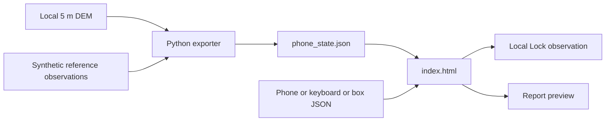

# RIDGELINE phone prototype

Team 8, Code Metal Forge. A map-free, offline-capable interface for a synthetic GPS-denied pilot scenario near Mount Moran. All positions describe the supplied synthetic scenario. No person's location, image, or device location is used.

## What this is

One dependency-free HTML file loads a small terrain JSON file from the same local server. The five screens show sensor fallback, peak aiming, route direction, injury-based stopping, and a report preview. This is a deterministic scenario replay, not a field navigation system.

The interface uses the recorded orientation when Lock is pressed, but advances fixed precomputed estimates. Changing the order of the peaks does not recompute the posterior. The footer identifies this as a scenario replay.

## Run

Open PowerShell in this folder, then run the exporter and server.

```powershell
python -I export_phone_state.py
python -I -m http.server 8768 --bind 127.0.0.1
```

Open [the local prototype](http://127.0.0.1:8768). Opening the HTML as a file is not supported because browsers restrict fetching the adjacent JSON. After edits, reload the page. All application assets are local, so no internet connection is needed after starting the server.

The exporter was verified with Python 3.13, NumPy 2.2.6, SciPy 1.16.1 and rasterio 1.5.2. These packages were already installed. A fresh environment needs them to regenerate the JSON, but the browser needs no packages or CDN.

```powershell
python -I -m pip install numpy==2.2.6 scipy==1.16.1 rasterio==1.5.2
node verify_ui.mjs
```

The default reference is `C:\Users\seika\Obsidian\3_Resources\attachments\2026-11-07_CodeMetalForge_地図見本\stats.json`. Use `--stats <path>` when moving the prototype. The exporter reads `input/dem_5m.tif`. The supplied 10 m file is retained but is not sufficient for this exporter's fine-slope check. The 1 m source archive is not needed and was not copied into the Vault.

## Show the demo

① Press **J** to turn GPS off. Auto-PACE switches to terrain mode. Press **Enter** on Find my position.

② Aim at Pk 3666. Start from 130°, press **Right 7 times** to reach 144°, then **Enter**. For Mt Moran, press **Left 8 times** to reach 128°, then **Enter**. For Pk 3388, press **Right 17 times** to reach 162° and **Down 4 times** to reach 11°, then **Enter**. A Lock needs both angles within 4° of the current target and a usable input. The 4° gate is a demo interaction threshold, not a localization accuracy claim.

③ The arrow points toward the next model-route point, about 90 m away. Turning the device or pressing left and right rotates it relative to the current heading. The route is about 6.72 km and 140 minutes in the model. There is no walking-position feed or waypoint advancement yet.

④ Press **I** to select the injured 18° limit. The arrow disappears and the screen shows **Stay. Signal. Wait.** Press I again to return to the 30° mode.

⑤ Press **R** to restore the simulated radio link. The report includes the synthetic estimate, model radius, UTC fix time and movement state. Copy demo report copies JSON locally. Nothing is sent to a server, radio, ATAK or another person.

| Control | Action |
| --- | --- |
| Left and right | Turn 2° per press |
| Up and down | Change elevation angle 1° per press |
| Shift with arrow | Fine adjustment at one quarter of the normal step |
| Enter | Activate a focused button, or Lock when the main aim area has focus |
| N | Cycle through remaining peaks without recording a Lock |
| J | Toggle simulated GPS availability |
| I | Toggle injury after three Locks |
| R | Open the restored-radio report after three Locks |
| B | Return from the report to guidance, otherwise return to sensors |
| S or ? | Open settings or keyboard help |
| Escape | Close settings |

Drag the skyline horizontally to turn, vertically to tilt. This works only in keyboard mode. Starting a new fix from the sensor screen clears the previous observations.

## Orientation adapters

All three sources feed the same heading and elevation state. The current source is selected in Settings. Source changes clear the last sample and relative calibration.

**Keyboard & drag** supplies synthetic true-north angles. It does not access any sensor.

**Phone sensor** uses DeviceOrientation events. Enable it with the button, which requests permission where the platform requires it. Point the back camera toward the peak. The adapter uses the device rotation matrix and the negative device Z axis, so the aiming ray is independent of the display's portrait or landscape rotation. Generic absolute orientation uses the Earth reference, while WebKit compass heading is treated as magnetic. Relative orientation cannot Lock until calibrated to a known wall target. Near-vertical aiming rays with an undefined horizontal bearing are ignored.

Phone behavior, platform-specific compass reference, sensor noise, calibration, HTTPS permission and actual heading accuracy remain unverified on hardware. The readout is a prototype, and magnetic declination is an unverified 0° placeholder. East declination is added to magnetic bearing and wrapped to 0–359°. True-north input is not corrected a second time. No geolocation API is called.

**Box JSON** is a validated adapter and manual test input. A future transport can call the function below. No WebSocket, serial, Bluetooth, LoRa or network transport is implemented.

```javascript
window.PhoneOrientation.setSource('box');
window.PhoneOrientation.ingestBox({
  heading_deg: 144,
  elevation_deg: 15,
  north_reference: 'true',
  timestamp: new Date().toISOString()
});
```

Accepted north references are `true`, `magnetic` and `relative`. The box should supply true or magnetic north. Relative calibration is currently available only for the phone adapter. Heading must be a finite number from 0 inclusive to 360 exclusive, elevation from -90 to 90. Samples older than 4 seconds or more than 1 second in the future are rejected. A source with no usable sample in 4 seconds cannot Lock and has no movement arrow. The manual JSON field's initial fixed timestamp is deliberately stale, so replace it with a current ISO 8601 timestamp when testing.

The Lock output has the same shape for every source.

```json
{
  "peak_id": "peak_1",
  "peak_name": "Pk 3666",
  "bearing_true_deg": 144,
  "elevation_deg": 15,
  "timestamp": "2026-11-08T00:00:00.000Z"
}
```

Listen for `window`'s `phone-observation` CustomEvent or call `window.PhoneOrientation.getObservations()`. The event contains a copy of the observation. It is not transmitted. Settings also shows all recorded observations.

For a later phone test, use a user-approved HTTPS tunnel to the local server, for example `cloudflared tunnel --url http://localhost:8768`. No tunnel was started during this task. A tunnel makes the served folder accessible through its URL, so review the directory before enabling it.

## Data generation and limits

The exporter adapts the geometry, Bayesian likelihood and route equations from the supplied `make_map_preview.py`, without importing or modifying that script. It reads the 5 m derived raster, creates a roughly 30 m model grid, replays the three reference bearings and exports five states. Bearings are corrected from UTM grid north to local true north.

Each state contains an estimate, 360 skyline elevation angles, horizon distances and coverage flags, all peak projections, visible peaks, a 95% model radius and posterior-region area. The final state also supplies a 201-point route and a rendezvous. The injury route is explicitly unavailable, with no points.

The confidence radius is the distance around the estimate containing at least 95% of the model posterior, with half a grid-cell diagonal added. The final radius is 506 m, while the synthetic error for this one scenario is 42.41 m. These are different quantities. The 506 m radius is not the equivalent-area circle of the reference's 0.124 km² region and is not calibrated real-world coverage.

The initial barometer-only estimate is very uncertain and cannot see the requested peaks. In this case the UI explicitly uses the final demo reference skyline. After the first Lock, the current estimated skyline is used when that target is visible. The same explicit fallback applies if a skipped target is not visible from a current estimate.

The healthy route enforces 30° on the roughly 30 m average slope and 45° on the maximum fine slope. Its maximum fine slope is about 38.36°. Therefore 30° is a model-grid limit, not a promise that every step is below 30°. The 18° model has no connected route. Water is a flat-area heuristic, not a surveyed hydrography layer. Trees, rivers, trail access, snow, cliffs below grid resolution and other field hazards are not validated. The UI labels this a terrain-only demo route.

The model records the measured elevation angle but does not use it to update localization. It uses a 6° compass standard deviation and 25 m barometer standard deviation. These are scenario assumptions, not measurements of the actual device. Distant peaks outside the raster are absent. Most peak labels are elevation-based identifiers rather than verified geographic names.

MGRS, actual radio transmission, CoT integration, live backend localization, waypoint progress and hardware transport remain P1 work.

## Design decisions

The supplied `04_skyline.png` is the primary visual reference. The palette keeps white instructions, cyan uncertainty, yellow target and red stop states. Text is at least 20 CSS px, major distances at least 48 CSS px, with a local system font fallback for Noto Sans JP. There are no external fonts, pictures or animation assets. Controls use 8 px corners and main actions have 56 px minimum height. The only motion is the orientation-driven skyline and direction arrow, with reduced-motion support.

The user's suggested sources were read without installing anything.

| Reference | Applied guidance |
| --- | --- |
| [Vercel agent skills](https://github.com/vercel-labs/agent-skills/tree/main/skills/web-design-guidelines) and [Web Interface Guidelines](https://github.com/vercel-labs/web-interface-guidelines/blob/main/command.md) | Keyboard actions, visible focus, tabular numerals, reduced motion, safe-area padding |
| [Taste Skill](https://github.com/Leonxlnx/taste-skill/blob/main/skills/taste-skill/SKILL.md) | Shared alignment edges, one primary task, consistent spacing and plain copy |
| [VoltAgent Linear](https://github.com/VoltAgent/awesome-design-md/blob/main/design-md/linear.app/DESIGN.md) | Near-black canvas, slightly raised surfaces and fine borders |
| [VoltAgent SpaceX](https://github.com/VoltAgent/awesome-design-md/blob/main/design-md/spacex/DESIGN.md) | A single dominant visual focus |
| [VoltAgent DJI](https://github.com/VoltAgent/awesome-design-md/blob/main/design-md/dji/DESIGN.md) | Large numerical hierarchy |

Marketing photography, decorative entrance animations and tiny interface text were not relevant to this task. Refero live search was unavailable because its subscription was inactive, so the supplied reference and bundled craft guidance were used. The implementation was checked visually in the in-app browser.

## Sources

- [USGS 3D Elevation Program](https://www.usgs.gov/3d-elevation-program), elevation data provider.
- [OpenTopography](https://opentopography.org/), source access and original raster assembly.
- The provided metadata identifies WY_GrandTetonElkRefuge_2014, WY_GrandTetonNP_D22 and WY_North_Converse_2020_D20 as source surveys. The supplied rasters are derived 5 m and 10 m data in EPSG 26912.
- [W3C Device Orientation and Motion](https://www.w3.org/TR/orientation-event/), coordinate conventions and permission behavior.
- [MDN DeviceOrientationEvent](https://developer.mozilla.org/en-US/docs/Web/API/DeviceOrientationEvent), browser API reference.

## Updating and stopping

Edit `index.html` for interface changes. Change `export_phone_state.py` for the precomputed model, regenerate the JSON, then reload. Run the Node checks after interaction changes. Preserve the schema when replacing the demo with the team's live computation.



Stop the local server with Ctrl+C in its terminal. Reloading resets the browser demo. Nothing is installed as a service and no automation was created.

All files are in `C:\Users\seika\Obsidian\_ai\workspace\2026-11-08_codemetal_phone_screen`. The complete file list is in [FILES.md](FILES.md), and verification evidence is in [VALIDATION.md](VALIDATION.md). The next reviewer is Claude Code. No Team-8 files, 3D-map files, notes, branches, commits or remotes were changed.
