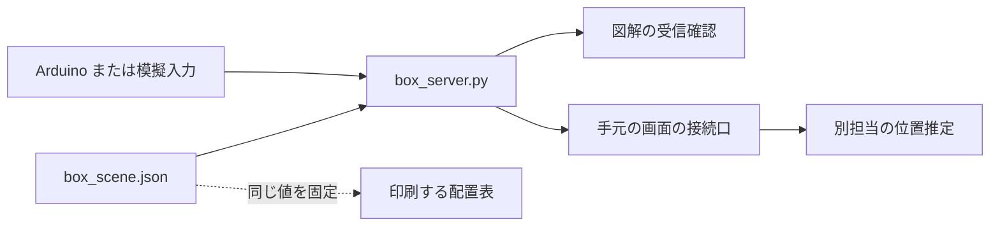

# 照準の箱の使い方

2026年11月7日 EST。ソフトの模擬動作を確認済み。実機は部品の型番確認待ち。

## これは何

箱を組み立てる図解、山の絵の配置表、Arduinoから届く向きと傾きを画面に送るプログラム。位置や道の計算は含まない。



GPSはスイッチで代役を務め、高さは場面の値を使う。位置、山、観測は山岳のデモ用であり、実在の人の位置は含めていない。実地のナビゲーションや救助で検証したものではない。

## 使い方

① このフォルダでPowerShellを開き、模擬サーバーを起動する。Pythonの標準機能だけで動き、追加のインストールは要らない。

```powershell
python -I box_server.py --demo
```

② [組み立てガイド](http://localhost:8765/guide.html)を開く。手順0から11の前へ、次へ、一覧の切り替えが使える。チェックはこのブラウザのlocalStorageに保存し、保存できない環境では表示中だけ保持する。閲覧しただけでは合格にならない。

③ 手順8で受信を開始する。模擬モードは26秒ごとに、GPS切替、Mt Moranへの方位合わせ、3回のLockを繰り返す。模擬の山の切替は離散的で、実機の滑らかな回転を再現するものではない。

④ [配置表](http://localhost:8765/poster_sheet.html)で半径と照準の高さを設定し、配置を更新する。既定は半径2.5 m、高さ1.3 m。印刷用レイアウトで設営表1枚と山頂マーク3枚を確認し、A4横で印刷する。床から測る位置は各マークの十字の中心。実際の印刷と会場への設置は未確認。

⑤ 実機では、Arduino、Grove板、IMU、OLEDの表裏の印字を写真で確認する。その後にボード定義、センサー用ライブラリ、配線、前方向を決定する。現状は型番不明のため本番のbox_firmware.inoを作成していない。

⑥ ボードの認識、確認用スケッチ、本番ファームウェアが確認できたら、実際のUSBポートを指定する。115200 baudが既定。pyserialは実機モードだけで必要。

```powershell
python -I box_server.py --port COM5
```

COM5は例。今回確認したCOM3とCOM4はBluetooth用で、Arduino用ではない。arduino-cliとpyserialは未導入。インストールと書き込みは対象を説明してから行う。確認用スケッチ2本も、まだコンパイルと実機書き込みをしていない。

## 受信仕様

USBはUTF-8のJSONを改行で区切り、1秒に10行送る。tは起動からのミリ秒、yawは右回りが正、pitchは水平0度で上が正。btnとlongは押している間の値ではなく、離した瞬間の1行だけ1にする。2秒以上の長押しではlongだけを1にし、btnは0。ボタンのチャタリング除去と長さの判定は、型番確認後に作るファームウェア側で行う。

```json
{"t":12345,"yaw":123.4,"pitch":14.8,"btn":0,"long":0,"gps":1}
```

longでMt Moranに合わせ、短押しをPk 3666、Mt Moran、Pk 3388の順に受け取る。方位合わせ自体はLockに数えない。校正前の短押しは無効。方位は次の式を0度以上360度未満へ折り返す。

```text
bearing_true = (Mt Moran bearing + current yaw - calibration yaw) mod 360
```

SSE（サーバーから画面へ流し続ける接続）は `http://localhost:8765/events`。名前付きイベントのため、onmessageだけではLockを受け取れない。

```javascript
const box = new EventSource('http://localhost:8765/events');
box.addEventListener('lock', event => {
  const observation = JSON.parse(event.data);
  // {peak, bearing_true, elev_deg, time} を画面の観測入力へ渡す
});
box.addEventListener('state', event => {
  const state = JSON.parse(event.data);
  // 再接続時は state.locks で一覧を置き換える。追記すると二重になる
  // state.demo と state.connected と state.calibrated を画面に表示する
});
```

| イベント | 内容 |
| --- | --- |
| state | 接続直後と状態変更時の全状態。demo、session、locks、target、orientation等 |
| orientation | 10 Hzを目安にyaw、bearing_true、elev_deg、gps、time。校正前のbearing_trueはnull |
| calibration | Mt Moranに方位を合わせた結果。yaw_zeroと時刻 |
| target | 次に指す山。calibrateは方位合わせを求める場合true |
| lock | peak、bearing_true、elev_deg、timeの4項目 |
| reset | 模擬周期、USB再接続、デバイス時計の再起動等の理由 |
| notice | 校正前の短押し等の通知 |

Lockの例。

```json
{"peak":"Pk 3666","bearing_true":143.715,"elev_deg":14.8,"time":"2026-11-08T01:00:00.000+00:00"}
```

時刻はUTCのISO形式。実機と模擬でLockの4項目は同じ形にし、模擬の区別はstate.demoとorientation.demoで渡す。3件受信後はawaiting_estimatorであり、position_fixはfalseのまま。成功の3回ブザーは位置推定側との連携ができてから追加する。

Arduinoへ返す行は次の形。本番ファームウェアはこれを受けてOLEDを更新する必要がある。実機での受信は未確認。

```json
{"cmd":"aim","peak":"Mt Moran","calibrate":true}
{"cmd":"aim","peak":"Pk 3666","calibrate":false}
{"cmd":"await_estimator"}
```

USBが3秒間有効な行を出さない場合と、USB切断時には校正とLockを消す。再接続後は再校正が必要。壊れた行、重複t、連続して立ったままのパルスを二重Lockにしない。約49.7日のmillis折り返しは再起動と区別する。

サーバーは127.0.0.1だけで待ち受ける。同じPCのlocalhostからのCORS接続を許可し、別端末のスマホからは直接つながらない。SSEが遅れてキューが満杯になったクライアントは切断し、再接続のstateで復帰する。Last-Event-IDによる古いイベントの再送は行わない。

## 場面と配置の根拠

phone_state.jsonのlock_3.visible_peaksを優先し、その最終推定地点で3つの山を固定した。元のobservations列の角度とは異なるため、既存の模擬地図がそのまま同じ推定結果を返すとは限らない。地図側へ接続する担当は、この場面と位置計算を対応させる必要がある。

| 山 | 真北からの方位 | 見上げる角度 | 半径2.5 mで前 | 右 | 上 |
| --- | --- | --- | --- | --- | --- |
| Mt Moran | 126.166° | 14.654° | 2.50 m | 0.00 m | 0.65 m |
| Pk 3666 | 143.715° | 14.800° | 2.38 m | 0.75 m | 0.66 m |
| Pk 3388 | 159.364° | 10.624° | 2.09 m | 1.37 m | 0.47 m |

山頂マークの輪郭は模式図で、実際の稜線を再現していない。Pkの名前は標高による仮ラベル。Groveの図も口の対応を表す模式図であり、実機の配置は写真確認後に修正する。

## 更新の仕組み

自動更新はない。box_scene.jsonがサーバーの場面の正で、poster_sheet.htmlにも同じ値を埋め込んで単体で開けるようにしている。場面を変えるときはCodexへ両方の同時更新と整合性確認を依頼する。今回の範囲はこのフォルダだけなので、共通のAIツール取説の索引は変更していない。

組み立て手順の原本はチームのメモにあり、このリポジトリには入れていない。今回の違いは、山の順をphone_state.jsonへ合わせたこと、位置推定の前に成功音を鳴らさないこと、未特定の機種を図で断定しないこと。

## やめたいとき

起動したPowerShellでCtrl+Cを押す。ガイドの受信を停止してもサーバーそのものは止まらない。自動起動や定期実行は作っていない。Groveのケーブルを抜き差しする前にはUSBを抜く。

## 検証と未完了

`python -I test_box_server.py` は14項目成功。校正前の短押し、長押しの分離、角度の折り返し、重複パルス、時計再起動、millis折り返し、切断、3観測後の状態、不正行、遅いクライアント、配置計算、HTTPとSSEの実接続を確認した。

Codex内蔵ブラウザで12段を表示し、前へと次へ、チェック保存後の再読込、模擬3Lockの受信、半径変更による再計算、印刷レイアウト4枚の収まりを確認。両ページの警告とエラーのコンソール記録は0件。テストで付けたチェックは解除済み。viewportの390 px指定が実際の表示幅に反映されなかったため、スマホ幅の確認は未完了。保存不可の環境でのlocalStorage動作もブラウザでは未検証。

実機、コンパイル、書き込み、OLEDへのコマンド受信、USBケーブルの認識、各段の数字による合否、実際の印刷、手元の画面と3D地図への接続は未確認。本番ファームウェアは型番確認後に作成する。pyserialとArduino CLIを導入したとは報告しない。

## 出典

地形は [USGS 3DEP](https://www.usgs.gov/3d-elevation-program) と [OpenTopography](https://opentopography.org/)。提供済みのstats.jsonとphone_state.jsonが数値の直接の参照元。

電圧の切替は [Seeed Studio Base Shield V2](https://wiki.seeedstudio.com/Base_Shield_V2/)を確認。BNO055の非磁気モードは [Bosch BNO055データシート](https://cdn-learn.adafruit.com/assets/assets/000/125/776/original/bst-bno055-ds000.pdf)、BNO085のGame Rotation Vectorは [Adafruitの説明](https://learn.adafruit.com/adafruit-9-dof-orientation-imu-fusion-breakout-bno085?view=all)を参照。実物がこれらの型番だと確認した意味ではない。

## ファイルの場所

ファイルはこのフォルダにあるもので全部で、作業の記録はリポジトリの外のチームのメモにある。

手元の画面のチャットに伝える文。

`box_server.py --demo` の `http://localhost:8765/events` へEventSourceで接続し、名前付きlockイベントの `{peak,bearing_true,elev_deg,time}` を受け取り、再接続時はstate.locksで置換してください。場面はbox_scene.jsonで固定したlock_3の見える山で、元の模擬観測とは異なります。
