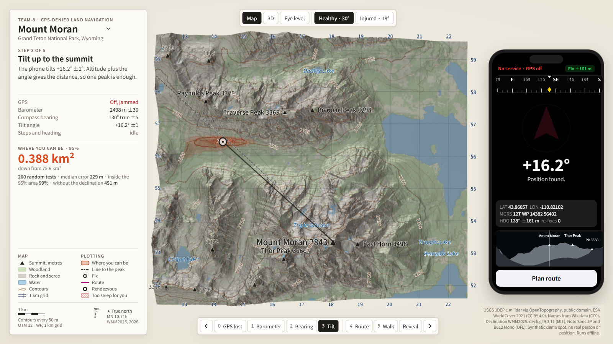

# Team-8 terrain viewer (prototype)

GPS-denied land navigation, judge view. A person with no GPS is located from a pre-loaded map tile,
a barometer, and pointing a phone at one well-known summit, then walked out on slopes that are safe for their condition.
One HTML page, deck.gl 9.3.11 shipped locally, no network and no API keys at run time.

The map is drawn like a printed topographic sheet (woods, rock, water, contours, a 1 km UTM grid, a collar with
scale bar and declination), and any mountain on Earth can be added with four commands.



## Open it

* Double-click `index.html`. It reads `data/areas.js` and `data/<area>/bundle.js` (images as data URLs), so it works from `file://` offline.
* Or serve the folder with `python -m http.server 8792` in this folder, then open http://localhost:8792/.
* Pick the mountain in the sidebar title, or open `?area=moran`, `?area=washington`, `?area=fuji`.
* Any window size works. The panels are one layout designed at 1440 x 760 and zoom down together. Under 760 px wide
  only the phone and the step bar stay.

## Add a mountain

```
python -I scripts/team8_fetch_area.py --id rainier --name "Mount Rainier" --region "Washington, USA" --center 46.8529 -121.7604 --size-km 10 8 --dem 3dep10
python -I scripts/team8_terrain_prep.py .cache/rainier data/rainier
python -I scripts/team8_simulate.py data/rainier
python -I scripts/team8_bundle.py data/rainier
```

`--dem 3dep10` is the USGS 1/3 arc-second DEM (United States), `--dem cop30` is Copernicus GLO-30 (anywhere),
and `--dem file --dem-file <tif>` takes a local GeoTIFF such as a 1 m lidar mosaic. The fetch step reads only the
needed window from cloud-optimised GeoTIFFs, plus ESA WorldCover land cover and Wikidata names inside the box.
The magnetic declination for the tile is computed offline with WMM2025 (`scripts/team8_wmm.py --test` checks it
against the NOAA test values). Simulate takes about a minute because it runs 200 random test spots
(`TEAM8_MC=50` makes it faster). Bundle rewrites `data/areas.js`, so the new tile appears in the picker.
Needs rasterio, numpy, scipy, contourpy and Pillow. Downloads are cached in `.cache/`, which git ignores.

## What the judge sees

| Step | Map | Phone (no map) |
| --- | --- | --- |
| 0 GPS lost | the whole tile is possible | no service, no fix |
| 1 Barometer | one contour band, altitude ±30 m | altitude |
| 2 Bearing | pencil line from the summit along the true bearing ±5°, after the stored declination | skyline strip with the peak boxed |
| 3 Tilt | the elevation angle gives the distance, the fix is a circle with a dot | lat, lon, MGRS |
| 4 Route | A* with Tobler time, red hatching where it is too steep for you | distance, time, arrow |
| 5 Walk | trail animation, dead-reckoning circle that grows and re-fixes | compass tape, arrow, next instruction, live coordinates |
| Reveal | the hidden true spot and its distance from the fix | error in metres |

The sidebar always shows the honest test result for the tile (200 random spots where the summit is in view,
random sensor noise at the stated sigma).

| Tile | Elevation data | Demo fix error | Healthy route | Median error | p90 | Truth inside 95% area | Summit in view from | Without declination |
| --- | --- | --- | --- | --- | --- | --- | --- | --- |
| Mount Moran | USGS 1 m lidar, shown at 5 m | 32 m | 6.5 km, 2 h 25 min | 229 m | 681 m | 99% | 26% of the land | 451 m, 77% (10.7° E) |
| Mount Washington | USGS 1/3 arc-second | 28 m | 2.7 km, 1 h 38 min | 243 m | 679 m | 97% | 6% | 720 m, 66.5% (14.2° W) |
| Mount Fuji | Copernicus GLO-30 | 60 m | 3.3 km, 2 h 14 min | 264 m | 622 m | 98% | 28.5% | 527 m, 80% (8.0° W) |

No tile has a safe route with an injured ankle (18° limit, half speed), so the phone says STAY, SIGNAL, WAIT.

Toggles `Map`, `3D`, `Eye level` (first-person view from the fix, drag to look around), `Healthy 30°` and `Injured 18°`.
Keys are the left and right arrows for the step, space to pause the walk, Q and E to turn the phone.
Deep links such as `?area=fuji&step=5&t=2400&view=3d&health=healthy`, plus `still=1` for headless screenshots.

## Design rules

* A printed topographic sheet that moves. Conventions follow USGS US Topo, swisstopo and CalTopo. Green woods,
  grey rock, blue water with italic names, brown contours with bold index lines and elevation labels along the line,
  a 1 km UTM grid with its digits on the edge, summits as black triangles with names and heights.
* The collar sits at the bottom of the sidebar, as on a paper map. Scale bar, contour interval, UTM zone and
  100 km square, and a declination diagram that turns with the map.
* Plotting follows the paper habit of land navigation. A pencil line to the landmark, the fix as a circle with a dot.
  Three plotting colours only, red-orange for where you can be, magenta for the route, red for danger.
* Relief shading from the north-west with cool shadows, so the mountain reads at a glance without a dark theme.
* The phone stays a dark phone, because that is what the person in the field holds.
* One button style, `aria-pressed` on toggles, `aria-current` on the active step, visible focus rings, a label on
  the walk slider, and `prefers-reduced-motion` turns off the camera flights, the count-down and the auto walk.

## Files

| File | Content |
| --- | --- |
| `index.html` | the page, its styles and its code |
| `data/areas.js` | the list of tiles the page can open |
| `data/<area>/bundle.js` | everything one tile needs, as one script (mesh PNG, map JPEG, slope PNG, three probability PNGs, meta, sim) |
| `data/<area>/terrain_meta.json` | bounds, grid, decoder, contours and their labels, UTM grid ticks, declination, peaks, lake and glacier names, credits |
| `data/<area>/terrain_rgb.png`, `terrain_rgb_mesh.png` | Mapbox terrain-RGB, h = -10000 + (R*65536 + G*256 + B) * 0.1, EPSG:4326 grid, edges = `bounds` |
| `data/<area>/topo.jpg` | the printed-map texture (land cover tints, relief shading, water, contours, 1 km grid) |
| `data/<area>/slope.png` | slope in degrees x 2 on a 30 m smoothed surface. The route planner and the red hatching read the same file |
| `data/<area>/sim.json` | truth (hidden), measurements, stage areas and outlines, estimate, routes, phone legs, skyline, the Monte Carlo test |
| `scripts/` | fetch, prep, simulate, bundle, the WMM2025 model and its coefficients, the font packer |
| `lib/deck.gl@9.3.11/` | deck.gl standalone bundle and its MIT license |
| `lib/fonts/fonts.css` | Noto Sans JP and B612 Mono as data URLs, because Chrome blocks font files on `file://` |
| `screenshots/` | 1600 x 900 headless captures of the three tiles |

The first version (one tile, dark theme, PR #2) stays in the git history.

The deck.gl bundle parses terrain only in a web worker downloaded from a CDN. `index.html` therefore passes its own
loader (`GridTerrainLoader`) that decodes the PNG on the main thread and builds a regular grid mesh. That is what
makes it work offline.

## Plugging in the team's code

* Position (Rohan). Write each step as a PNG in the probability format on the same bounds
  (R = 255 * sqrt(P / Pmax)), and put the stage areas and the estimate in `sim.json` under `stages` and `estimate`.
* Route. `sim.json` holds `routes.healthy` and `routes.injured` (`null` means no safe route), each with
  `path`, `timestamps`, `length_m`, `time_s`, `max_slope_deg`. `legs` holds the phone instructions.
* Any web map can use `topo.jpg` and the probability PNGs as image overlays with `bounds`.

## Model (mock)

Grid Bayes filter on 10 m cells. Barometer Gaussian σ 30 m, bearing Gaussian σ 5° (x 0.02 where the summit is
hidden by terrain), elevation angle Gaussian σ 1° with curvature and refraction (k = 0.13). The compass reading
is corrected with the declination stored in the tile, because a phone without GPS cannot look it up.
Route by A* with Tobler off-trail speed (x 0.6), slope limit on a 30 m smoothed DEM, cliffs and water blocked,
injured walks at half speed. Dead reckoning on the phone, 4% step-length error and 3° heading bias, the circle grows
5% of the distance and re-fixes when it grows 90 m past the fix radius.

Not modelled yet. The same DEM is used for truth and model, forest and night hide summits, real sensor noise,
summits outside the tile, and choosing the landmark automatically (the summit is in view from only 6% to 28.5% of
the land, which is why that is the next step).

## Credits

* Mount Moran elevation, USGS 3DEP 1 m lidar via OpenTopography (WY_GrandTetonElkRefuge_2014, WY_GrandTetonNP_D22,
  WY_North_Converse_2020_D20), public domain.
* Mount Washington elevation, USGS 3DEP 1/3 arc-second DEM, public domain.
* Mount Fuji elevation, Copernicus DEM GLO-30, © DLR e.V. 2010-2014 and © Airbus Defence and Space GmbH 2014-2018,
  provided under COPERNICUS by the European Union and ESA, all rights reserved.
* Land cover, ESA WorldCover 10 m 2021 v200, © ESA WorldCover project 2021, contains modified Copernicus Sentinel data (2021)
  processed by the ESA WorldCover consortium, CC BY 4.0.
* Summit, lake and glacier names from Wikidata, CC0.
* Declination from the World Magnetic Model WMM2025, NOAA NCEI and the British Geological Survey, public domain.
* deck.gl © vis.gl contributors, MIT. Noto Sans JP © Google and B612 Mono © The B612 Project Authors, both SIL OFL 1.1
  (via Fontsource).
* The demo spots are synthetic, no real person or position is stored.
